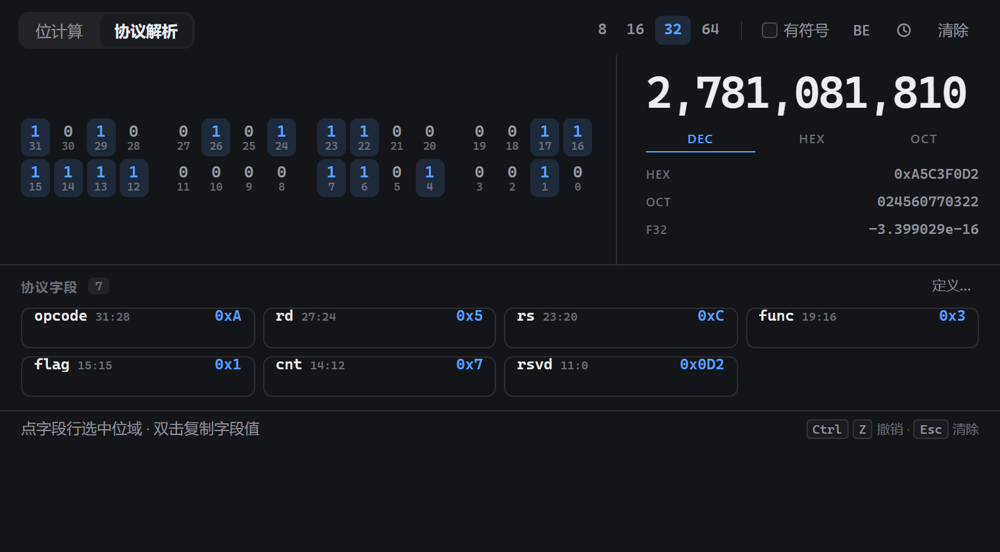
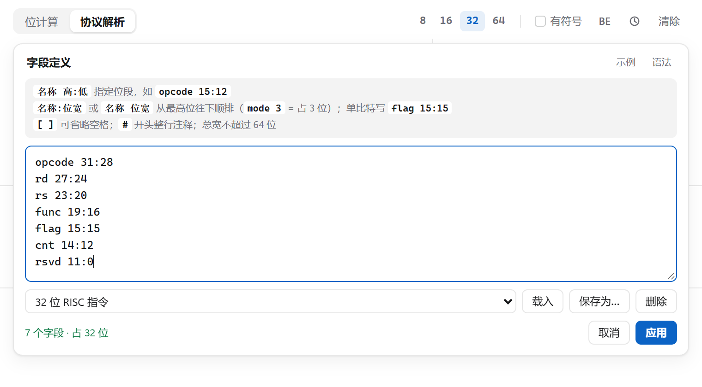
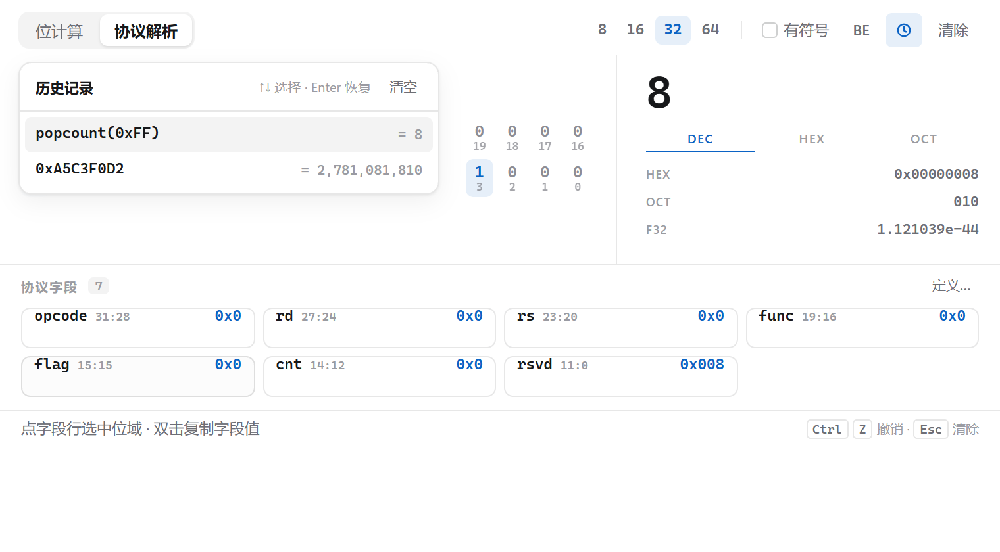

# bitcalc — uTools 位计算器

一个给**看寄存器、写驱动、调协议**的人用的位计算器：左边 64 格 bit 网格，右边是当前数值；拖一段位域，它既是取值窗口也是写值目标；切到协议解析，同一批位立刻按字段名读出来。

> uTools 插件，纯前端实现（HTML/CSS/JS + BigInt），无框架、无构建、零依赖。当前版本 0.6.0，尚未发布到插件市场。


## 为什么不是又一个「程序员计算器」

市面上的表达式计算器已经够多（uTools 内的 Code Calc 有 8,784 用户）。这个插件只赌一件事：**把「数值」和「位」放在同一个视野里，并且让选区两头都能用**。

| 常见做法 | 这里怎么做 |
| --- | --- |
| 算完给一串数字，位状态靠自己心算 | 64 格网格常显，位号淡显，鼠标停在一格时同组 4 格一起亮 |
| 位域靠表单填「名称-范围-长度」 | 直接**框选 bit**，选区即字段；输入数字就写回这一段 |
| 无符号/有符号要切来切去 | 切换是全局开关，浮点、字节序、位宽都跟着自适应 |
| 协议字段要开另一个工具 | 内置协议解析模式：`opcode 15:12` 一行一个字段，点行即选中 |
| 算过的式子找不回来 | 历史记录留最近 60 条，Ctrl+H 打开，↑↓ 选、Enter 恢复 |

## 功能

**表达式**
- 全 64 位 BigInt 运算：`+ - * / %`、`<< >>`、`& | ^ ~`、比较、括号
- `pow / abs / min / max / log2`
- 位级函数（无符号 64 位视角）：`popcount / clz / ctz / bswap / bitrev / rol / ror`
- 进制字面量：`0xFF`、`0b1010`、`0o777`、十进制

**网格**
- 点格翻转，拖选位域，`Esc` / 「清除」取消
- 位号常驻淡显，鼠标进网格时同组 4 格（一个十六进制位）一起亮，被指的那一位深一档
- 每 4 格一组、组间留缝，64 位也一眼能按 HEX 位读
- 位宽 8 / 16 / 32 / 64，窗口高度跟着变
- 有符号 / 无符号、字节序 BE / LE、IEEE754 `f32` / `f64` 读数

**数值面板**
- 大字显示当前值；有选区时显示**选中段**的值（变蓝，并标注 `位 a–b`）
- 大字下可切 DEC / HEX / OCT，切完点大字直接复制该进制的字符串
- 右侧三行读数（HEX / OCT / F64 或 F32）**永远是整值**，不随选区变

**位域即读写窗口**
- 选中 15:12 → 右侧大字变成该字段的值，整段套一个实线框
- 输入 `0xF` → 只改这 4 位，其余位不动（BitCalc 的 `setval` 语义）
- 切窄位宽后，超出范围的旧字段会标橙「超界」，并在状态行提示数量，不会悄悄变成 0

**协议解析模式**
- 字段定义：`opcode 15:12`（位范围）或 `mode:3`（位宽，从最高位向下铺），`#` 注释
- 字段以胶囊排成两列，名字、位段、值一行看完；点胶囊 → 选中该位域；悬停字段行 → 网格出虚线框；悬停网格 → 对应字段行高亮
- 定义框里**三段语法常驻**在顶部，不用记；「示例」按钮一键填一段可改的样板
- **边写边校验**：行号 + 原因就地提示，有错时「应用」不生效，不会把好定义冲掉
- 位域重叠会提示「N 处重叠」——不阻止应用（叠着看同一批位是合法用法），但要说一句
- **命名方案**：`保存为…` 起名存起来，下拉选一个点「载入」即可切换；删除是两段式确认
- 字段定义、方案、位宽/符号/字节序/模式都存本地，重进插件自动恢复

**历史记录**
- 每次算成功自动记一条（表达式 + 当时的值 + 位宽 + 符号），900 ms 防抖，不逐键刷屏
- `Ctrl+H` 打开浮层，`↑ ↓` 选、`Enter` 恢复、点外面或 `Esc` 关闭；`清空` 一键清空
- 记的是**当时的快照**：算完立刻 Ctrl+Z，历史里留的仍是算出来的那个值

## 截图

| 深色 | 协议解析（7 个字段） |
| --- | --- |
|  |  |

| 字段定义：常驻语法 + 方案 | 历史记录 |
| --- | --- |
|  |  |

## 在 uTools 里加载

**方式一：开发者工具（推荐，能改代码）**
1. 拿到本仓库：`git clone https://github.com/qmjianda/utools-bitcalc.git`，或在 GitHub 页面 `Code → Download ZIP` 解压
2. uTools → 应用市场旁的「开发者工具」→ 新建项目 → 选择仓库根目录（含 `plugin.json`）
3. 保存后主输入框输入 `bitcalc` 进入

**方式二：只用不开发**
在 uTools 开发者工具里打包成 `.upx` 后安装（本仓库暂未提供 release 包）。

进入插件后按 [`TESTING.md`](TESTING.md) 的清单逐项验证。

## 指令

| 输入 | 触发 |
| --- | --- |
| `bitcalc` | 位计算器（主入口，不带参数） |
| `0xFF`、`0b1010`、`0o777` | 「位计算」条目，带入即算 |
| `1<<8`、`0xFF ^ 0x0F` | 「按位计算」条目，带入即算 |

普通词（`abc`、`12`）不会触发，避免污染搜索列表。

## 键盘与鼠标

| 操作 | 作用 |
| --- | --- |
| 单击格子 | 翻转该位 |
| 在格子上拖动 | 框选位域（单击和拖动按 3px 阈值区分） |
| 双击字段行 | 复制该字段值（`0x…`） |
| 点大字 / 读数行 | 复制对应数值（大字按当前 DEC/HEX/OCT 进制） |
| `Esc` | 逐层关闭：方案表单 → 定义框 → 历史浮层 → 清除选区 |
| `Ctrl+H` | 打开/关闭历史记录 |
| `Ctrl+Z` | 撤销上一步数值改动（输入框里不拦，交给系统撤销） |
| `Ctrl+Enter` | 在定义框里直接应用 |
| 字段行聚焦后 `↑ ↓` / `Home` / `End` | 在字段间移动选中 |
| 字段行聚焦后 `Enter` / 空格 | 选中当前字段 |

## 本地存储

优先用 `utools.dbStorage`（uTools 自带、可随插件数据备份），不可用时退回 `localStorage`，再不行退到内存（功能仍可用，只是关掉就丢）。键名：

| 键 | 内容 |
| --- | --- |
| `bitcalc.settings.v1` | 位宽、符号、字节序、上次所在模式 |
| `bitcalc.fields.v1` | 当前字段定义原文 |
| `bitcalc.schemes.v1` | 命名方案列表（最多 40 个，名字最多 24 字） |
| `bitcalc.history.v1` | 历史记录（最多 60 条，同式同值去重） |

## 开发与自测

```bash
node test-parser.js          # 表达式引擎，149 用例
node test-proto.js           # 字段定义，168 用例
node test-store.js           # 存储/历史/方案，43 断言
node dev/audit.mjs 760 420   # 无头 Chrome 真实交互回归，31 条断言
node dev/audit.mjs 560 420   # 窄窗回归
node dev/audit.mjs 760 420 --shots   # 顺便出 README 用的 5 张图（dev/audit-*.png）
node dev/peek.mjs "#grid .cell"      # 打印某棵子树的标签/矩形/颜色，查布局用
node dev/cdp.mjs                     # 旧版位置/尺寸断言（含悬停、位宽、字节序、F32）
```

`dev/audit.mjs` 会自己起一个静态服务（默认 9348 口）并注入 uTools 桩，走真实的 `dbStorage` 路径；需要本机装有 Chrome（路径可用环境变量 `CHROME` 覆盖）。注意：headless Chrome 在受限沙箱里常因 crashpad 起不来，需要放宽权限或换 `--no-sandbox` 类环境。

`dev/` 下还有：`peek.mjs` 布局探针，`cdp.mjs` 旧断言集，`layout-demo.html` 本轮改版时的视觉草案（V0–V5，可 `?v=v5&theme=dark` 单看），以及早期截图脚本 `shot.mjs` / `shot2.mjs` / `shot-demo.mjs`。

浏览器直接打开 `index.html` 可预览（底部多一个调试输入框）；`index.html#utools` 隐藏它，模拟 uTools 内的样子。

## 结构

```
plugin.json       uTools 插件描述（指令、正则触发）
index.html        布局骨架
style.css         新布局样式（左位右值、字段胶囊），浅/深两套
parser.js         表达式：tokenizer + 递归下降，全程 BigInt
grid.js           网格：按位宽重建、翻转、拖选、位域外框
proto.js          字段定义：parseSpec / decode / overlaps / specToText（零 DOM）
store.js          持久化：设置 / 字段 / 方案 / 历史（dbStorage → localStorage → 内存）
main.js           粘合层：状态、渲染、交互、快捷键、uTools API
test-parser.js    149 用例
test-proto.js     168 用例
test-store.js     43 断言
dev/audit.mjs     无头 Chrome 交互回归 + README 截图
TESTING.md        uTools 内人工实测清单
```

## 已知限制

- **未在真机 uTools 里跑完整清单**：切位宽时窗口高度（`utools.setExpandHeight`）仍是最大不确定项，TESTING.md 里单独列了观察项
- 二进制不另设读数行：位网格本身就是二进制视图，64 位再多一行 BIN 只会挤掉网格
- 协议模式下字段表比网格高时，网格在区域内垂直居中，上下会留白（不拉伸格子）
- 历史只记表达式，不记「拖选 / 点格翻转」这类操作
- C 宏导出、变量、SVD 导入、MSB0/LSB0 切换：均未做，属于下一版候选
- 位宽 ≤ 16 时不显示浮点读数（f32 需要 32 位）

## 与原始 BitCalc（PyQt 桌面版）的语义差异

| 项 | BitCalc | 这里 |
| --- | --- | --- |
| `/` | Python 真除（浮点） | 截断整除，`7/2` = 3 |
| `%` | 符号随除数 | 符号随被除数 |
| 十进制前导零 | Python 3 报错 | 同样报错 |
| 超 64 位 | — | 截断显示低 64 位，不报错 |
| 位级函数 | — | 一律按无符号 64 位（`popcount(-1)` = 64） |
