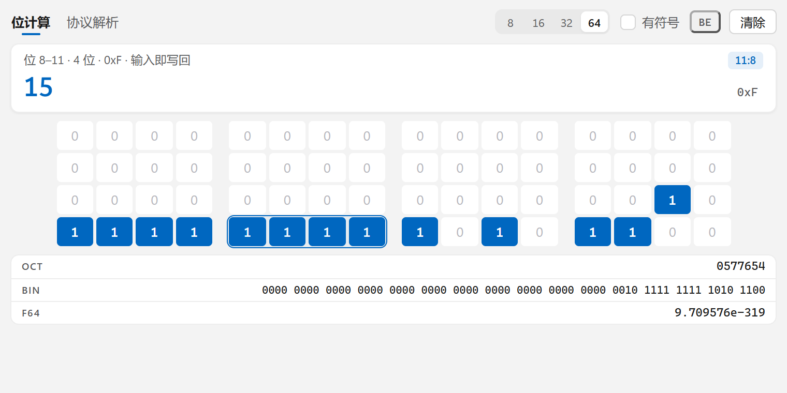
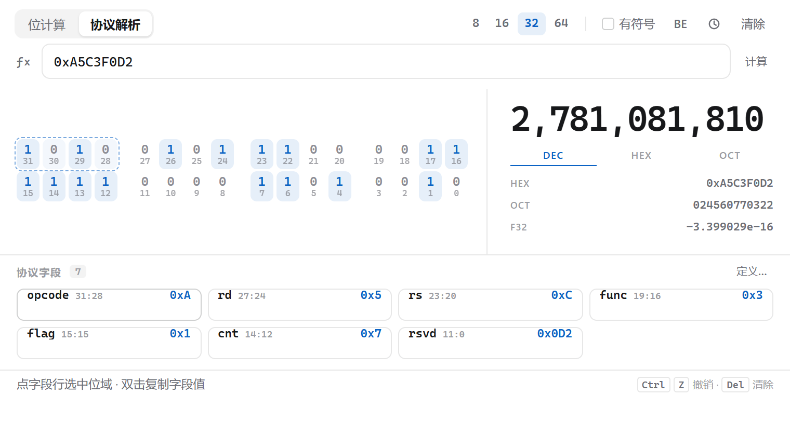
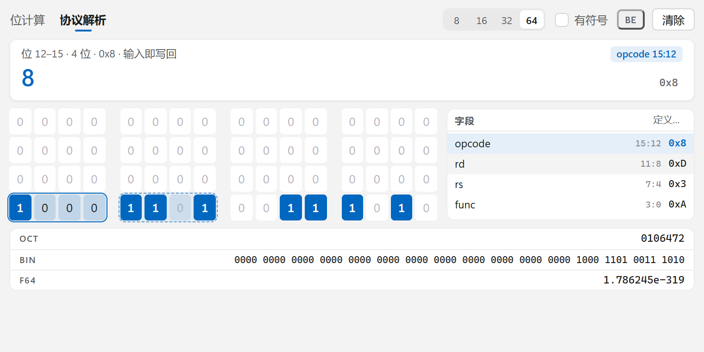
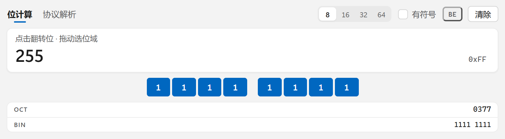

# bitcalc — uTools 位计算器

一个给**看寄存器、写驱动、调协议**的人用的位计算器：左边表达式算，右边 64 格 bit 网格同屏显示；拖一段位域，它既是取值窗口也是写值目标。

> uTools 插件，纯前端实现（HTML/CSS/JS + BigInt），无框架、无构建、零依赖。当前版本 v4 原型，**尚未发布到插件市场**。



## 为什么不是又一个「程序员计算器」

市面上的表达式计算器已经够多（uTools 内的 Code Calc 有 8,784 用户）。这个插件只赌一件事：**把「数值」和「位」放在同一个视野里，并且让选区两头都能用**。

| 常见做法 | 这里怎么做 |
| --- | --- |
| 算完给一串数字，位状态靠自己心算 | 64 格网格常显，悬停出位号，悬停一个 HEX 位时同组 4 格一起亮 |
| 位域靠表单填「名称-范围-长度」 | 直接**框选 bit**，选区即字段；输入数字就写回这一段 |
| 无符号/有符号要切来切去 | 切换是全局开关，浮点、字节序、位宽都随位宽自适应 |
| 协议字段要开另一个工具 | 内置协议解析模式：`opcode 15:12` 一行一个字段，点行即选中 |

## 功能

**表达式**
- 全 64 位 BigInt 运算：`+ - * / %`、`<< >>`、`& | ^ ~`、比较、括号
- `pow / abs / min / max / log2`
- 位级函数（无符号 64 位视角）：`popcount / clz / ctz / bswap / bitrev / rol / ror`
- 进制字面量：`0xFF`、`0b1010`、`0o777`、十进制

**网格**
- 点格翻转，拖选位域，右键/清除取消
- 位号按需出现：静止时只有 0/1，鼠标进网格才淡入（不堆视觉噪音）
- 位宽 8 / 16 / 32 / 64，窗口高度跟着变
- 有符号 / 无符号、字节序 BE / LE、IEEE754 `f32` / `f64` 读数

**位域即读写窗口**
- 选中 11:8 → 顶部大字变成该字段的值；整段套一个实线框
- 输入 `0xF` → 只改这 4 位，其余位不动（BitCalc 的 `setval` 语义）

**协议解析模式**
- 字段定义：`opcode 15:12`（位范围）或 `mode:3`（位宽，从最高位向下铺），`#` 注释
- 点字段行 → 选中该位域；悬停字段行 → 网格出虚线框；悬停网格 → 对应字段行高亮
- 定义存 localStorage，重进即恢复

## 截图

| 深色 | 协议解析 |
| --- | --- |
|  |  |

| 悬停字段（虚线框） | 位宽 8 |
| --- | --- |
|  |  |

## 在 uTools 里加载

**方式一：开发者工具（推荐，能改代码）**
1. 拿到本仓库：`git clone https://github.com/qmjianda/utools-bitcalc.git`，或在 GitHub 页面 `Code → Download ZIP` 解压
2. uTools → 应用市场旁的「开发者工具」→ 新建项目 → 选择仓库根目录（含 `plugin.json`）
3. 保存后主输入框输入 `bitcalc` 进入

**方式二：只用不开发**
在 uTools 开发者工具里打包成 `.upx` 后安装（本仓库暂未提供 release 包）。

进入插件后按 [`TESTING.md`](TESTING.md) 的清单逐项验证，重点看第 18 / 24 / 35 项。

## 指令

| 输入 | 触发 |
| --- | --- |
| `bitcalc` | 位计算器（主入口） |
| `0xFF`、`0b1010`、`0o777` | 「位计算」条目，带入即算 |
| `1<<8`、`0xFF ^ 0x0F` | 「按位计算」条目，带入即算 |

普通词（`abc`、`12`）不会触发，避免污染搜索列表。

## 开发与自测

```bash
node test-parser.js     # 表达式引擎，149 用例
node test-proto.js      # 字段定义，168 用例
node dev/shot2.mjs 760 380   # 无头 Chrome 驱动真实交互，出 6 张截图 + 断言
```

`dev/` 下是调试台：`shot.mjs` 静态截图，`shot2.mjs` 交互态（拖选、切模式、填定义、写回位域），`cdp.mjs` 位置/尺寸断言，`variants.html` 排版备选方案对比。需要本机装有 Chrome。

浏览器直接打开 `index.html` 可预览（底部多一个调试输入框）；`index.html#utools` 隐藏它，模拟 uTools 内的样子。

## 结构

```
plugin.json       uTools 插件描述（指令、正则触发）
index.html        布局骨架
style.css         Win11 风格样式，浅/深两套
parser.js         表达式：tokenizer + 递归下降，全程 BigInt
grid.js           网格：按位宽重建、翻转、拖选、位域外框
proto.js          字段定义：parseSpec / decode / overlaps / specToText（零 DOM）
main.js           粘合层：状态、渲染、交互、uTools API
test-parser.js    149 用例
test-proto.js     168 用例
TESTING.md        44 项 uTools 内实测清单
```

## 已知限制

- **未在真机 uTools 里跑完整清单**：切位宽时窗口高度（`utools.setExpandHeight`）是最大不确定项
- ESC 清除选区可能被子输入框拦截，行为待测
- 位域命名保存、C 宏导出、变量、SVD 导入、MSB0/LSB0 切换：均未做，属于下一版候选
- 位宽 ≤16 时不显示浮点读数（f32 需要 32 位）

## 与原始 BitCalc（PyQt 桌面版）的语义差异

| 项 | BitCalc | 这里 |
| --- | --- | --- |
| `/` | Python 真除（浮点） | 截断整除，`7/2` = 3 |
| `%` | 符号随除数 | 符号随被除数 |
| 十进制前导零 | Python 3 报错 | 同样报错 |
| 超 64 位 | — | 截断显示低 64 位，不报错 |
| 位级函数 | — | 一律按无符号 64 位（`popcount(-1)` = 64） |
